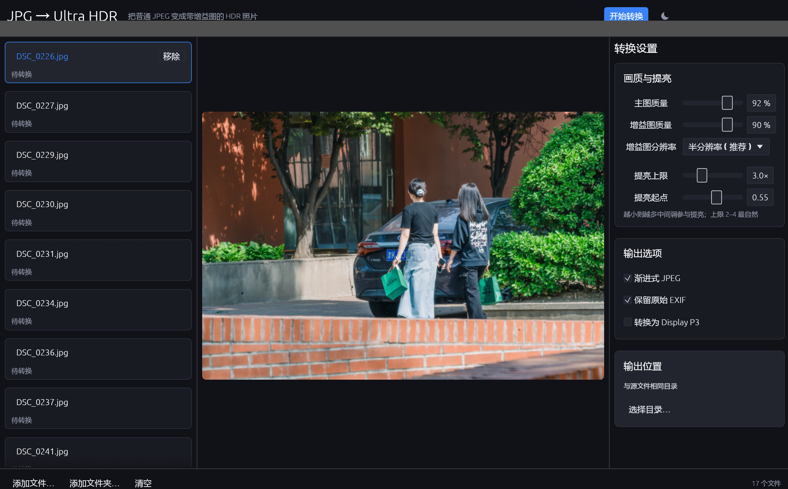
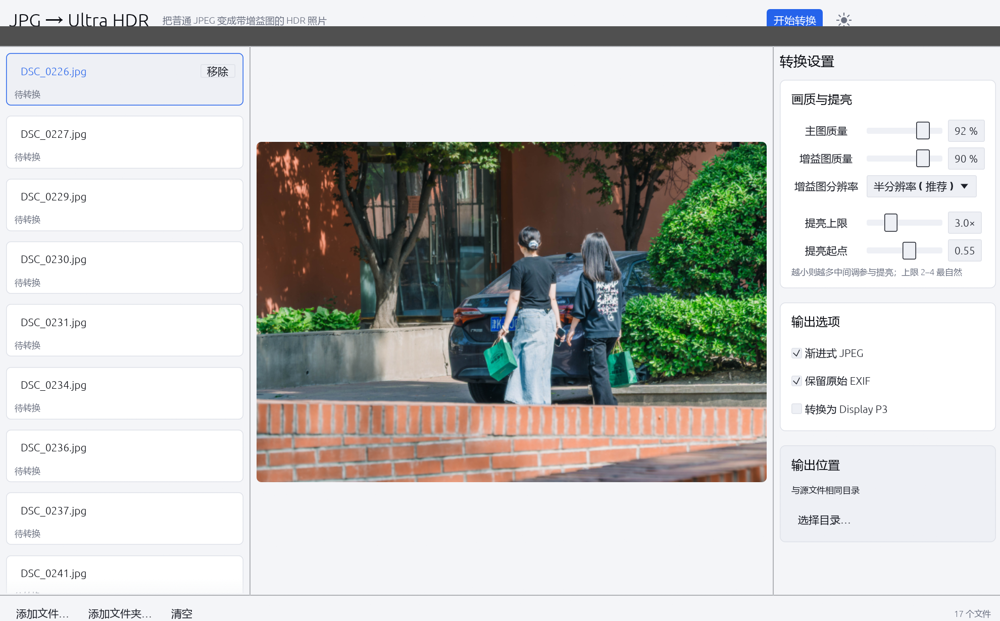

# JPG → Ultra HDR

把普通 SDR JPEG 照片转换成 **Ultra HDR** JPEG 的转换工具，同时提供 **Windows 桌面版**和 **Android 版**。

转换后的文件仍然是标准的、任何软件都能打开的 JPEG，只是额外附带了一张增益图（gain map）。
支持 HDR 的查看器（Windows 照片、Chrome / Edge、Google 相册、Pixel 手机等）会按增益图把高光提亮；
不支持的查看器看到的仍是完全正常的 SDR 画面，不会有任何色偏或异常。

Windows 版是单文件绿色程序，无需安装、无需 .NET 或 VC++ 运行库，双击即用。
两个平台共用同一套转换内核（`src/lib.rs`），只有界面层不同。

## 下载

不想自己编译的话，直接下打包好的版本：

> **Windows**：[JPG2UltraHDR-v0.1.1-windows-x64.zip](https://github.com/Kerman456/JPG2UltraHDR/releases/download/v0.1.1/JPG2UltraHDR-v0.1.1-windows-x64.zip) — 解压即用，含主程序、说明文档和两个检查工具。
>
> **Android**：[JPG2UltraHDR-0.1.1-arm64.apk](https://github.com/Kerman456/JPG2UltraHDR/releases/download/v0.1.1/JPG2UltraHDR-0.1.1-arm64.apk) — 直接装，需要 Android 10 或更高。



<details>
<summary>浅色主题</summary>



</details>

## 功能

- 批量转换：拖入文件或整个文件夹，按 CPU 与内存自动限制并发
- 实时预览：左侧点选文件，中间直接看原图
- 三档增益图分辨率（全 / 半 / 四分之一），体积与画质可权衡
- 可调提亮上限与提亮起点，控制高光展开的强度与范围
- 保留原始 EXIF / ICC；可选真正转换到 Display P3 并写入 P3 ICC
- 深 / 浅双主题，参数、输出目录、窗口尺寸与主题都会记忆到下次启动
- 已转换过的文件会被识别并跳过，不会重复叠加增益图

## 用法

### Windows 版

双击 `JPG转UltraHDR.exe`，然后：

- 把 JPEG 文件或整个文件夹**拖进窗口**
- 或点底部的「添加文件…」「添加文件夹…」
- 左侧点选文件可在中间预览
- 右侧调整参数，点右上角「开始转换」

输出默认写到源文件同目录，文件名加 `_hdr` 后缀：`DSC_0227.jpg` → `DSC_0227_hdr.jpg`。
也可以把文件直接拖到 exe 图标上启动。

### Android 版

1. 打开 app，点 **添加图片** → 系统文件选择器里可以多选 JPEG
2. 按需调整「转换设置」里的参数。滑块轻点即到位置，横向拖动连续调整；竖直滑动是滚动页面，不会误改数值
3. 点 **开始转换**，每张图片下方会显示结果：分辨率、增益图尺寸、峰值倍数、文件大小
4. 点 **保存到相册**，结果写入 `Pictures/JPG2UltraHDR`

右上角的太阳/月亮按钮切换深色 / 浅色主题。详见 [android-app/README.md](android-app/README.md)。

## 参数

| 参数 | 默认 | 含义 |
|---|---|---|
| 主图质量 | 92 | SDR 主图 JPEG 编码质量 |
| 增益图质量 | 90 | 增益图 JPEG 编码质量 |
| 增益图分辨率 | 半分辨率 | 全 / 半 / 四分之一。半分辨率在体积与画质间最平衡 |
| 提亮上限 | 3.0× | HDR 显示时高光最亮可达 SDR 的多少倍。2–4 最自然，8 以上会明显失真 |
| 提亮起点 | 0.55 | 从哪个亮度开始参与提亮。越小则越多中间调被提亮 |
| 渐进式 JPEG | 开 | 渐进式编码，网络加载时逐层显示 |
| 保留原始 EXIF | 开 | 保留相机型号、拍摄时间、方向等 |
| 转换为 Display P3 | 关 | 把 BT.709 像素真正转换到 Display P3 并写入 P3 ICC |

## 它是怎么工作的

普通 JPEG 只有 SDR 信息，没有真正的 HDR 数据，所以增益图必须「推导」出来。这里的做法是：

1. 用 zune-jpeg 解码源图，取出像素、EXIF、ICC
2. 计算每个增益图采样块（半分辨率即 2×2 像素）中心点的感知亮度 `L`
3. 按一条平滑曲线推导提亮倍数：

   ```
   t    = smoothstep(knee, 1, srgb_oetf(L))
   gain = 1 + (max_boost - 1) · t
   ```

   暗部与中间调 `t ≈ 0`，倍数保持 1.0（画面完全不变）；越接近高光 `t → 1`，倍数越接近 `max_boost`。
4. 按 ISO 21496-1 的对数编码写成 8 位单通道增益图：
   `byte = 255 · ln(gain) / ln(max_boost)`
5. 交给 [ultrajpeg](https://github.com/jcayzac/ultrajpeg) 封装成完整的 Ultra HDR 容器

这条曲线正好是 `apply_gainmap` 解码时的逆运算，所以查看器重建出来的亮度就是预期值。

实测（DSC_0230，上限 3.0×）：50% 分位 1.00×，90% 分位 1.73×，99% 分位 2.75×，99.9% 分位 3.01×，
超过 1.0 线性亮度的像素占 7.8%——即暗部中间调原样不动，只有高光被推上去。

## 输出文件结构

```
SOI
 ├ APP0   JFIF
 ├ APP1   EXIF（原样保留）
 ├ APP1   XMP —— Ultra HDR 容器描述
 ├ APP2   ISO 21496-1（主图侧版本标记）
 ├ APP2   MPF —— 声明这是一张两图容器
 ├ APP11  COLOR —— 显式色域标记（仅当源文件没有 ICC 时写入）
 ├ DQT/SOF/DHT/SOS…  SDR 主图（真正的画面）
 └ 增益图 JPEG（半分辨率、单通道灰度）
```

## 兼容性

- **支持 HDR 的查看器**：按增益图渲染，高光更亮更有层次
- **普通查看器**（画图、旧版看图软件、网页）：只读第一张 JPEG，照常显示 SDR 画面
- 与 Google 的 Ultra HDR / Adobe 的增益图规范兼容（ISO 21496-1 + `hdrgm` XMP + MPF）

## 已知限制

- 增益图是**推导**出来的，不是真实拍摄的 HDR 信息。它做的是「让高光更亮」，不会凭空恢复已经过曝死白的细节。
- 已经在高光处削顶到 255 的区域，提亮后仍然是纯色块。
- 转换会重新编码主图，因此与原图有约 1–2/255 的平均像素差（JPEG 重编码损失）。想进一步减小可把主图质量调到 96–100。
- 目前只处理 JPEG 输入；PNG / HEIC / RAW 会先提示失败。

## 从源码构建

### Windows 版

需要 Rust 1.95 或更新的稳定版。

```bash
cargo build --release
# 产物：target/release/jpg2ultrahdr.exe
```

`.cargo/config.toml` 里给 MSVC 目标打开了 `+crt-static`，所以发布版不依赖 VCRUNTIME140.dll，
拷到任何 Windows 10 / 11 机器上都能直接跑。

### Android 版

见 [android-app/README.md](android-app/README.md)。需要 JDK 21、Android SDK 35、
NDK 27.3.13750724、`cargo-ndk`、rustup target `aarch64-linux-android`、Gradle 8.5，
然后：

```powershell
cd android-app
.\build-android.ps1 -Release
```

## 附带工具

`src/bin/` 下有几个开发期用的小工具，`cargo build --release` 会一并构建：

```bash
# 打印容器结构、增益图统计，并按 1.0/1.5/2.0 倍显示亮度重建 HDR
cargo run --release --bin inspect_hdr -- photo_hdr.jpg

# 量化核对各亮度分位的实际提亮倍数
cargo run --release --bin highlight_check -- photo_hdr.jpg 3.0

# 边界与健壮性测试（1×1、极端长宽比、灰阶、损坏文件、重复转换）
cargo run --release --bin edge_test

# 转换 + 回读验证
cargo run --release --bin verify -- src.jpg dst.jpg 3.0

# Display P3 路径冒烟测试
cargo run --release --bin p3_test -- src.jpg dst.jpg
```

## 实现说明

### 为什么不用 `ultrajpeg::decode` 读源文件

`ultrajpeg` 0.5.0-rc8 用 `find_jpeg_boundaries` 把文件切成码流，而它会把相机 JPEG 里
嵌在 EXIF 中的缩略图误判成第二张图，于是主图被截断、解码直接报
`I/O errors Not enough bytes, expected 1 but found 0`。

所以本项目绕开了它的解码路径：用 zune-jpeg 整文件解码拿到像素和原始 EXIF / ICC，
只在最后的封装环节交给 `ultrajpeg::encode`（它只写不切，没有这个问题）。
`src/bin/diag.rs` 就是当时定位这个 bug 留下的诊断工具。

### 为什么增益图是自己算的

`ultrajpeg::compute_gain_map` 内部把 `max_content_boost` 硬编码成 6.0 且不可调，
而且需要先构造一张浮点 HDR 图（每像素 8–16 字节）。这里改为直接按同样的公式
逐块算出 8 位单通道增益图，既能把提亮上限开放给用户，内存占用也只有增益图本身的大小。

## 技术栈

| 部分 | 技术 |
|---|---|
| 转换内核（共用） | Rust · ultrajpeg 0.5.0-rc8（Ultra HDR 封装）· zune-jpeg 0.5（解码）· mozjpeg-rs 0.9（编码） |
| Windows 界面 | eframe / egui 0.36 + modern-egui 0.2 |
| Android 界面 | egui 0.35（含 `vendor/egui` 触摸补丁）+ egui-android-framework 0.4.0-alpha.4 |

## 目录结构

```
src/               转换内核 + Windows 界面 + 开发工具
  lib.rs           解码、增益图推导、Ultra HDR 封装（两个平台共用）
  main.rs          Windows GUI
  config.rs        设置持久化
  bin/             诊断与小工具
android-app/       Android 工程（独立 crate，依赖 ../ 的内核）
  src/lib.rs       界面逻辑（M3）
  src/design.rs    Material Design 3 组件库
  android/         Gradle 工程
  vendor/egui      打过触摸滚动补丁的 egui 0.35
```

## 许可

MIT OR Apache-2.0，任选其一。
