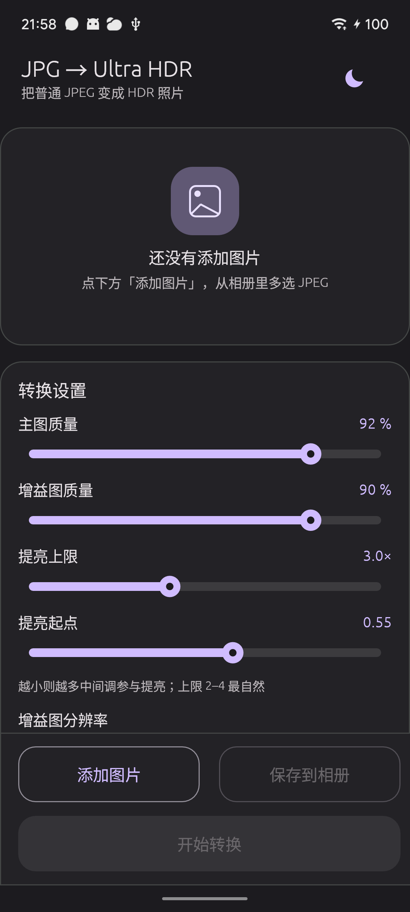
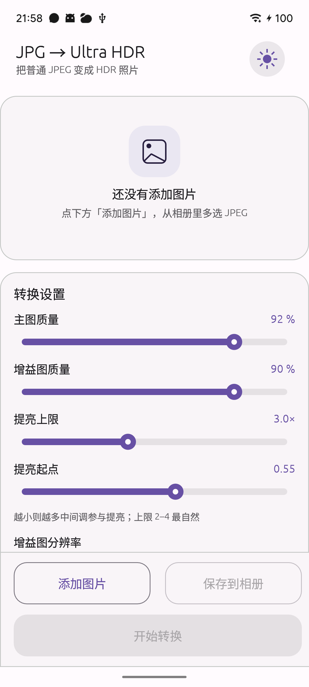

# JPG 转 Ultra HDR · Android 版

把普通 JPEG 照片转换成 **Ultra HDR JPEG**（带增益图、MPF 容器、ISO 21496-1 元数据）的
Android 应用。转换内核与 Windows 版完全共用（仓库根目录的 `src/lib.rs`），界面用
[egui-android-framework](https://github.com/toffeantyri/egui-android-framework) 搭建，
并按 **Material Design 3** 规范重绘了全部控件（色板、圆角、层级、动效）。

## 安装

APK 只有 **arm64-v8a**（现代手机都是这个架构），系统要求 **Android 10（API 29）或更高**。

```bash
adb install -r JPG2UltraHDR-0.1.0-arm64.apk
```

也可以直接把 APK 传到手机上，用文件管理器点开安装（需要允许「安装未知来源应用」）。

已在 **MEIZU 20（Android 15，arm64-v8a）** 上实机验证：安装、选图、转换、保存到相册全流程正常。



<details>
<summary>浅色主题截图</summary>



</details>

## 用法

1. 打开 app，点 **添加图片** → 系统文件选择器里可以多选 JPEG。
2. 按需调整「转换设置」里的参数（见下表）。滑块轻点即到位置，横向拖动连续调整；
   竖直滑动是滚动页面，不会误改数值。
3. 点 **开始转换**，每张图片下方会显示结果：分辨率、增益图尺寸、峰值倍数、文件大小。
4. 点 **保存到相册**，结果写入 `Pictures/JPG2UltraHDR`，在系统相册里能直接看到。

右上角的太阳/月亮按钮切换深色 / 浅色主题。

转换结果也保留在 app 私有目录 `files/out/` 下，卸载 app 时一并删除。

## 参数

| 参数 | 默认 | 说明 |
| --- | --- | --- |
| 主图质量 | 92 % | SDR 主图的 JPEG 质量，越高越接近原图、体积越大 |
| 增益图质量 | 90 % | 增益图 JPEG 质量，对画质影响很小，可以调低省体积 |
| 增益图分辨率 | 半分辨率 | 全分辨率最准但体积大；四分之一最小，暗部过渡可能可见 |
| 提亮上限 | 3.0× | HDR 高光最亮能到 SDR 的多少倍；2–4 最自然 |
| 提亮起点 | 0.55 | 越小则越多中间调参与提亮 |
| 渐进式 JPEG | 开 | 渐进式体积更小，但部分老软件兼容性差 |
| 保留原始 EXIF | 开 | 携带相机型号、拍摄时间、GPS 等 |
| 转换为 Display P3 | 关 | 转成 Display P3 色域并写入 P3 ICC，色彩更鲜艳 |

## 界面设计

界面按 Material Design 3 从零实现，不依赖框架自带的 12 色主题：

- **色板**：由框架基础色按 M3 色调规则推导出 surface container 五级色阶
  （lowest / low / container / high / highest）以及 primary/secondary container，
  深浅两套各自独立推导。
- **组件**：TopAppBar（标题 + 副标题 + 主题圆钮）、Filled / Outlined Button、
  卡片（16 px 内边距、20 px 圆角、1 px 描边）、滑块（8 px 轨道 + 10 px 手柄 +
  按压光晕）、Switch（52×32 轨道，`animate_bool_with_time` 0.14 s 动效）、
  Segmented Button、Linear Progress，全部自绘。
- **排版**：标题 21 px、区块标题 16 px、正文 14 px、辅助信息 12–13 px，
  全部走系统 CJK 字体（Noto Sans CJK / Droid Sans Fallback）。

### 触摸手势

滑动和调参互不打架，靠的是**按手势首段位移锁定方向**：

- 手指按下后，累计位移第一次超过 10 px 时判定方向，之后整条手势都不再改变——
  是横向就只调数值，是纵向就只滚页面。
- 判定要用「本次按下点 → 当前位置」的累计位移，不能用每帧的 `pointer.delta()`
  （拖动时每帧只有几像素，横竖分量大小随机，方向会来回翻转）。
- 也不能用 `Response::is_pointer_button_down_on()`：它表示「egui 仍认为这次按下的
  目标是我」，而滑块只感知 click，手指一移动超过拖动阈值，egui 就把它清成 false——
  正好是最需要它为 true 的时刻。所以这里直接读 `pointer.primary_down()` 和
  `pointer.press_origin()`。

另外，`vendor/egui` 是 egui 0.35 的补丁版（见 `Cargo.toml` 的 `[patch.crates-io]`），
修了上游两个触摸缺陷，不应用它滑动会「突然闪到一个位置，且每次都从那一个位置开始」：

1. `PointerState::begin_pass` 里 `old_pos` 仍是上一帧位置，新一次按下时
   `pointer.delta()` 会算成「上一帧位置 → 本次按下点」的整段距离，可达数百像素。
2. `ScrollArea` 在 `drag_started` 时没有清掉上一次 fling 的残余速度。

## 它是怎么工作的

普通 JPEG 里没有任何 HDR 信息，所以「HDR」是**算出来的**：

1. 用 `zune-jpeg` 解码原图为 8-bit RGB。
2. 按像素算亮度：`srgb_eotf` 转到线性光，再用亮度系数 `[0.2126, 0.7152, 0.0722]` 加权。
3. 只提亮高光：`t = smoothstep((srgb_oetf(lum) - knee) / (1 - knee))`，
   增益 `gain = 1 + (max_boost - 1) * t`。≤ knee 的亮度完全不动，
   所以阴影和中间调和原图逐像素一致。
4. 增益量化成 8-bit：`byte = 255 · ln(gain) / ln(max_boost)`，
   与 `ultrahdr-core` 的 `GainMapLut` 解码公式一一对应。
5. 用 `ultrajpeg` 把 SDR 主图 + Gray8 增益图封装成 MPF Ultra HDR JPEG。

实测（2066 万像素样张，3.0× 上限）：50% 分位 1.00×、90% 分位 1.73×、
99% 分位 2.75×、99.9% 分位 3.01× —— 高光按设计达到设定峰值，暗部零改动。

## 与 Windows 版的关系

- **共用**：仓库根目录的 `src/lib.rs`（解码、增益图、封装、EXIF/ICC 处理全在这里）。
- **各自实现**：界面。Windows 用 eframe + modern-egui，Android 用 egui-android-framework。
- 桌面依赖通过 `[target.'cfg(not(target_os = "android"))'.dependencies]` 隔离，
  所以同一个内核 crate 能同时为两边编译。

## 从源码构建

需要：JDK 21、Android SDK（platform-tools / platforms;android-35 /
build-tools;35.0.0）、NDK 27.3.13750724、`cargo-ndk`、
rustup target `aarch64-linux-android`、Gradle 8.5。

```powershell
# debug
.\build-android.ps1

# release（自动 zipalign + 签名）
.\build-android.ps1 -Release
```

如果 Gradle 不在默认位置：

```powershell
.\build-android.ps1 -Release -GradlePath "C:\gradle\bin\gradle.bat"
```

产物：`android\app\build\outputs\apk\release\JPG2UltraHDR-0.1.0-arm64.apk`

手动分步：

```powershell
$env:ANDROID_NDK_HOME = "D:\Android\ndk\27.3.13750724"
cargo ndk -t arm64-v8a -o android\app\src\main\jniLibs build --release
cd android
$env:APP_LIB_NAME = "jpg2ultrahdr_android"
$env:APP_PACKAGE = "com.kerman456.jpg2ultrahdr"
gradle assembleRelease
```

## 已知限制

- 只出 **arm64-v8a**：`abiFilters` 里没有 x86_64，模拟器需用 arm64 镜像。
- 增益图是**推导**出来的，不是相机真实捕获的 HDR；已经过曝死白的高光无法恢复。
- 手机上 2000 万像素一张约需 150 MB 内存，所以并行数限制在 1–4 之间。
- 预览以列表形式呈现，没有大图预览（移动端价值不大，也不占内存）。
- 手机壁纸/相册类 App 里能否看到 HDR 效果取决于系统是否支持 Ultra HDR 显示；
  Android 14+ 的部分机型可正常显示。
- 应用包名 `com.kerman456.jpg2ultrahdr`，但 Activity 类必须留在
  `com.example.egui_android` —— 框架的 JNI 符号硬编码了这个类路径。

## 技术栈

Rust · egui 0.35（含 `vendor/egui` 触摸补丁）+ egui-android-framework 0.4.0-alpha.4（GUI）·
android-activity 0.6（GameActivity）· jni 0.21 · ultrajpeg 0.5.0-rc8（Ultra HDR 封装）·
zune-jpeg 0.5（解码）· mozjpeg-rs 0.9（编码）· Kotlin（系统文件选择 + MediaStore 写入）

## 许可

MIT OR Apache-2.0

